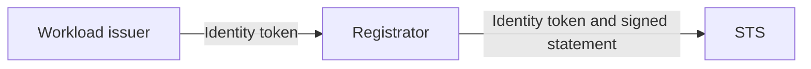
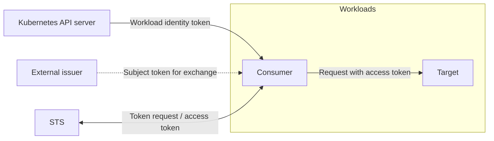
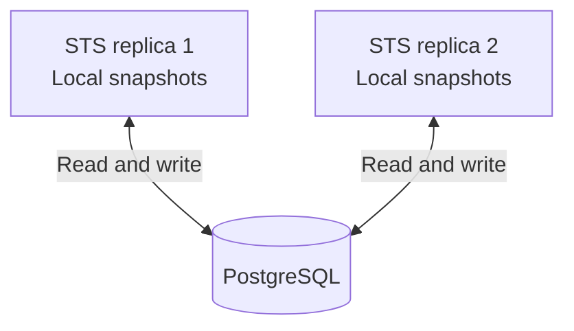
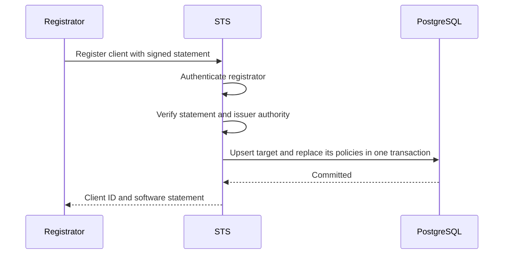
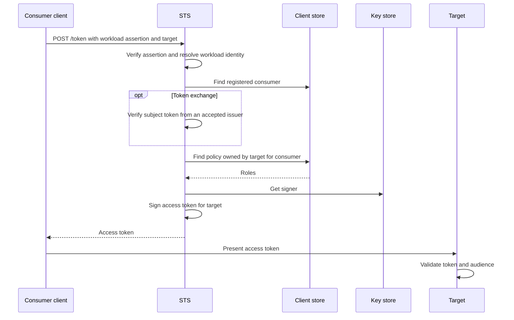
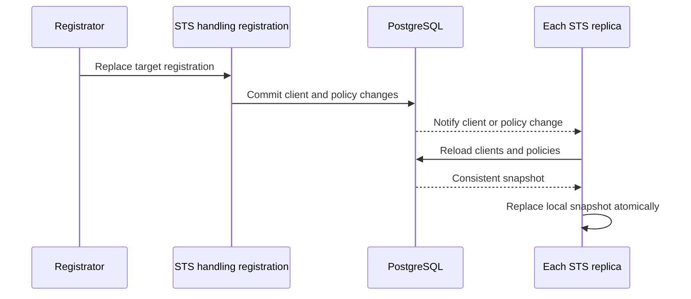
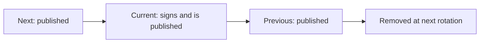

# Architecture

STS issues access tokens for Kubernetes workloads.
Registrators register clients and their authorization policies.

## Components

### Registration

Kubernetes issues a projected service account token to the registrator.
The registrator uses it to authenticate and submits clients and policies in a signed software statement.



### Token issuance and use

The consumer authenticates with its own workload token.
For token exchange, it also supplies a subject token.



Consumers present STS tokens to targets; STS does not proxy their requests.

### Shared storage

Replicas share registrations, policies, and signing keys in PostgreSQL.
Each replica keeps local snapshots for token requests.



## Project layout

Root shared directories:

```text
.mise-tasks/         Shared checks and component task aggregates
charts/              Helm chart
docs/                API guides and architectural decisions
hack/                Kubernetes manifests, sample data, and benchmark image Dockerfile
observability/       Grafana dashboard
```

Component directory `sts-authserver/`:

```text
sts-authserver/
  cmd/
    sts/               Service entry point
    setup_local_env/   Local database seed
    local_traffic/     Local load generator
    benchmark_report/  Benchmark report generator
  internal/
    api/               Server startup, routes, HTTP listeners
    config/            YAML configuration and defaults
    registration/      Registrator authentication and software statements
    oauth/             Client authentication, grants, authorization, token signing
    store/             PostgreSQL-backed client and signing-key stores
    cache/             Snapshot refresh and PostgreSQL notification listener
    database/          Connection, migrations, SQL queries, generated sqlc code
    metrics/           Token and HTTP metrics
    integration/       End-to-end and database tests (integration_test tag)
    ioconvenience/     Shared cleanup helpers
  .mise-tasks/         Local development, checks, and generation tasks
  Dockerfile           Service image
```

Code paths in the rest of this document are relative to `sts-authserver/`.
`internal/api` connects the registration and OAuth handlers to the same client store.
The OAuth handler also uses a signing-key store.
STS owns its routes and grant logic; it uses Zitadel OIDC types and helpers.
SQL lives in `internal/database/queries/`, with generated code in `internal/database/sqlgen/`.

## Identity and registration

### Workload identity

STS accepts workload tokens from configured client-auth issuers.
It identifies a client by the token's issuer, Kubernetes namespace, and service account name.
The registered client has a separate ID; STS does not derive it from those fields.

### Policy ownership

The registered target owns its authorization policies.
Each policy names a **consumer** that can request a token for that **target**, and lists the roles STS grants.
For example, `env1:namespace1:target` can grant `reader` to `env1:namespace1:consumer`.
Client credentials and token exchange look up the policy by `(owner=target, consumer=requesting client)`.

A registrator can manage clients only for its authenticated issuer.
Registrators with the same issuer share authority over those clients.

### Registration flow

The workload token authenticates the registrator.
The registrator signs the software statement with its own key.



See [Client registration](registration.md) for replacement, deletion, and request details.

## Token issuance

- **Client credentials:** The consumer is the token subject.
- **Token exchange:** The original subject remains; the consumer becomes the current actor in `act`.



Both grants authenticate the consumer with a workload token.
Token exchange also verifies a subject token; without configured subject-token issuers, STS supports only client credentials.

See [Client usage](usage.md) for request fields, issued claims, and chained exchange examples.

## PostgreSQL and snapshots

Token requests far outnumber registration changes.
Each replica caches all clients and policies to reduce database queries.
PostgreSQL stores the registrations and signing keys shared by all replicas.



- Database notifications, listener reconnections, and a one-minute timer trigger snapshot refreshes.
- Cache misses fall back to PostgreSQL and trigger a refresh when the entry exists.
- A failed refresh leaves the previous snapshot available.

Registration writes do not wait for snapshot refreshes.
Updates and deletions take effect in each replica's cache after a refresh.
Until then, any replica can serve stale data, including the replica that handled the write.
See [ADR 0001](adr/0001-cache-client-registrations-in-snapshots.md) for the trade-off and limits.

## Signing keys

STS creates a shared set of three ES256 keys in PostgreSQL on first startup.
Each replica loads its own key snapshot and signs with the current private key.
STS publishes all three public keys at `/jwks`.



STS publishes the next key before it uses it to sign, and keeps the previous key available for live tokens.
A PostgreSQL advisory lock ensures that only one replica rotates the shared set at a time.
Keys rotate when the current key expires.
A key rotation failure stops the affected replica.

STS encrypts each private signing key with XChaCha20-Poly1305 before storage.
See [Configuration](configuration.md#signing-key-encryption) for the shared encryption key and reset requirements.

## Startup and listeners

STS loads [YAML configuration](configuration.md), connects to PostgreSQL, and applies migrations at startup.
A database lock serializes migrations across replicas.
STS loads its snapshots and discovers configured issuers before serving requests.
The Helm chart mounts configuration and the shared encryption key from Secrets and runs multiple replicas against the shared database.

### Public listener

`bindAddress` serves discovery, token requests, public keys, and client registration.
See [Client usage](usage.md#endpoints) and [Client registration](registration.md#endpoints) for public routes.

### Internal listener

`internalBindAddress` serves:

- `/healthz`: Returns `ok` while the HTTP server responds.
- `/readyz`: Checks the PostgreSQL connection.
- `/metrics`: Exposes Prometheus metrics.
